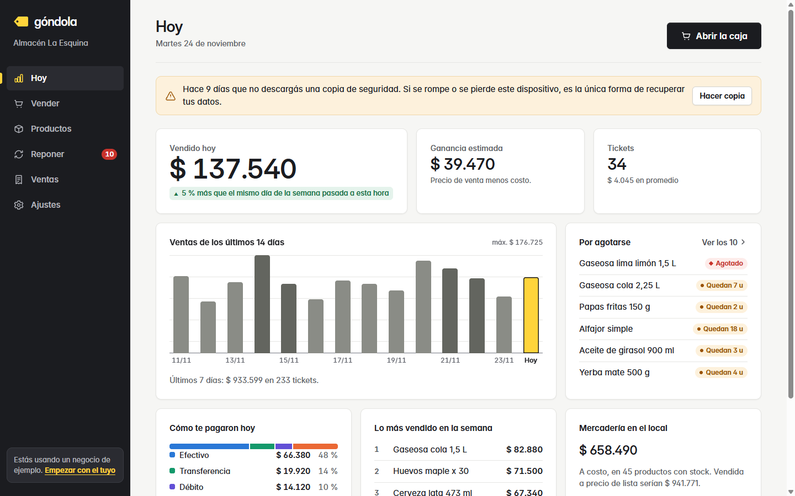
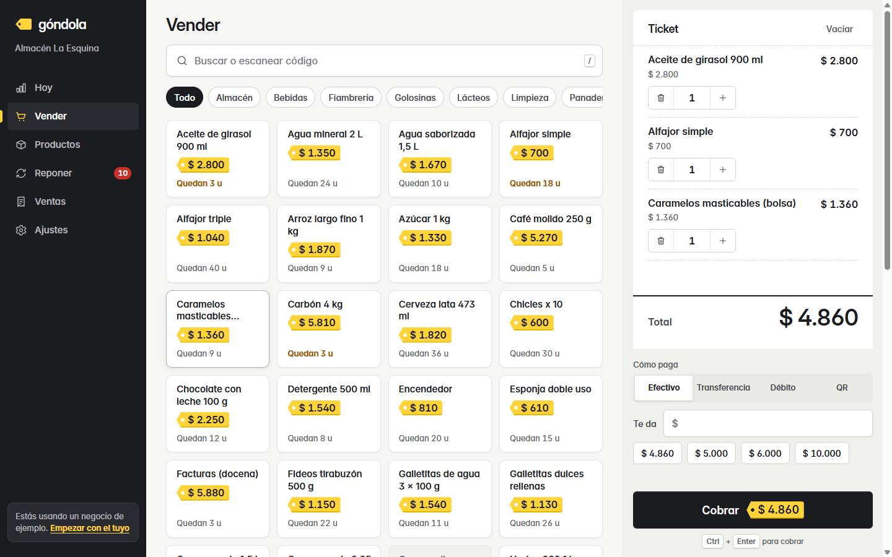
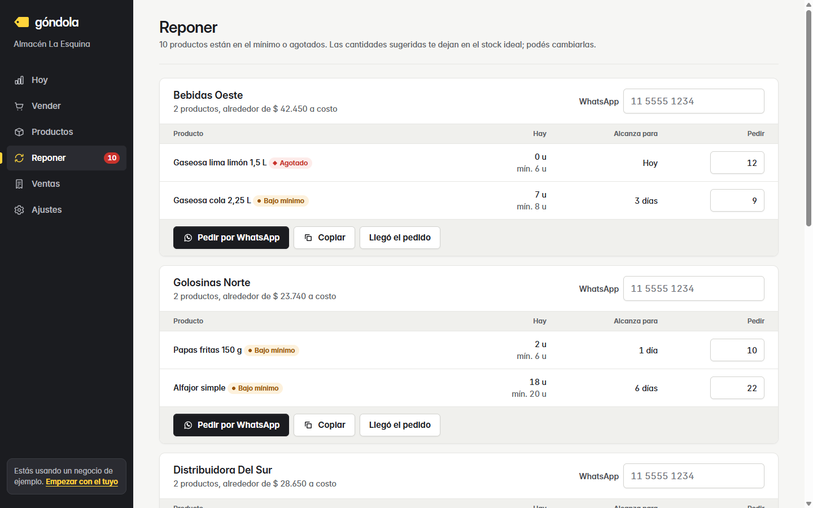
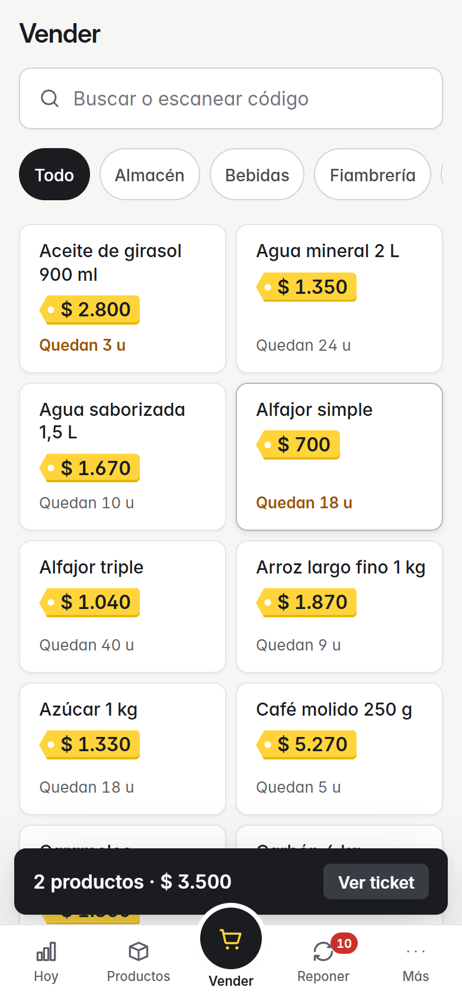
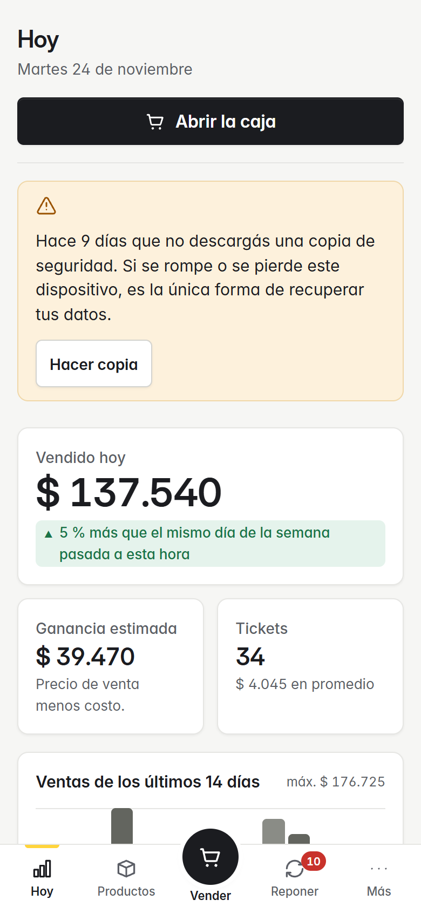

# Góndola

Control de stock gratis para almacenes, kioscos, dietéticas y ferreterías de barrio. Se usa desde el celular o la compu del mostrador, **funciona sin internet** y no pide cuentas ni pagos.

**[Probar Góndola →](https://fran951xd.github.io/GONDOLA/)** (tocá "Probar con un ejemplo" para ver un almacén con un mes de ventas)



## El problema

En la mayoría de los negocios chicos el stock se lleva de memoria, en un cuaderno o en una planilla que nadie actualiza. Se nota cuando falta algo y el cliente se va, cuando se pide de más a un proveedor o cuando al cerrar no queda claro cuánto se vendió ni cuánto se ganó. Los sistemas de gestión que existen suelen ser pagos, piden cuenta e internet, y están pensados para negocios más grandes.

Góndola resuelve lo básico, rápido y bien: **vender, saber qué falta y pedirlo**.

## Qué hace

| | |
|---|---|
| **Caja rápida** | Buscás o escaneás (sirve un lector USB, que "escribe" el código y Enter), armás el ticket, elegís efectivo, transferencia, débito o QR y calcula el vuelto. Al cobrar, descuenta el stock solo. Los productos por kilo aceptan peso o monto ("$ 2.000 de queso"). Se puede deshacer un cobro. |
| **Productos** | Costo, ganancia y precio: si cambiás uno, se recalculan los otros, con redondeo a $10, $50 o $100. Stock mínimo, stock ideal, proveedor y código de barras (con la cámara del celular donde el navegador lo permite). |
| **Aumentos de precio en bloque** | "+8 % a Bebidas" o a un proveedor, con vista previa de cómo queda cada precio antes de confirmar y opción de deshacer. |
| **Reponer** | Lo que está en el mínimo o agotado, agrupado por proveedor, con cuántos días alcanza al ritmo de venta actual y la cantidad sugerida para volver al stock ideal. Un botón arma el **pedido listo para mandar por WhatsApp**, y otro registra la mercadería cuando llega (actualizando costos si cambiaron). |
| **Movimientos** | Entrada de mercadería, pérdidas (roturas o vencidos) y recuentos, con el historial de cada producto. |
| **Hoy** | Vendido en el día comparado con el mismo día de la semana anterior, ganancia estimada, tickets, ventas de los últimos 14 días, cómo te pagaron, lo más vendido y cuánta plata hay en mercadería. |
| **Ventas** | Tickets por día con su detalle; se pueden anular y el stock vuelve. |
| **Tus datos, seguros** | Copia de seguridad en un archivo (con recordatorio semanal), restauración, importación de productos desde Excel o Google Sheets (CSV) y exportación. |

| Caja | Reponer |
|---|---|
|  |  |

<p align="center"> </p>

## Decisiones de diseño y técnicas

- **Offline primero.** Los datos viven en el dispositivo (IndexedDB) y la app se guarda con un service worker: abre y funciona sin conexión, y se instala como app en el celular o la compu. Se le pide al navegador almacenamiento persistente para que no borre los datos por falta de espacio.
- **Integridad de los datos.** Una venta guarda el ticket, descuenta el stock y deja un movimiento por producto **en una sola transacción**: si algo falla, no queda nada a medias. Cada cambio de stock queda registrado con su motivo, así el historial siempre explica el número actual.
- **Sin servidor ni cuentas.** Nadie más ve los datos del negocio. A cambio, la responsabilidad del respaldo es del usuario, y por eso la app lo recuerda, explica cómo hacerlo y valida las copias antes de restaurarlas.
- **Sin frameworks ni dependencias.** HTML, CSS y JavaScript con módulos ES. Carga rápido en celulares modestos y no hay paquetes que mantener.
- **Lógica separada de la interfaz.** Las reglas del negocio (redondeo de precios, ganancia sobre costo, cantidad a pedir, días de stock, resumen de ventas, aumentos, búsqueda sin tildes, lectura de planillas con formatos argentinos) son funciones puras en `js/logica.js`, con 20 tests unitarios.
- **Pruebas de punta a punta.** `tests/e2e/flujos.py` recorre la app en Chromium como lo haría una persona: carga productos, vende con lector y por kilo, deshace, repone, recibe mercadería, aumenta precios, hace recuentos, copia de seguridad, restauración e importación, y abre la app **sin internet**.
- **Accesibilidad.** Todo se usa con teclado (atajos `/` para buscar y `Ctrl + Enter` para cobrar), los diálogos son nativos y devuelven el foco, los grupos de opciones siguen los patrones de WAI-ARIA, los cambios se anuncian a lectores de pantalla y los estados de stock nunca dependen solo del color.
- **Identidad visual.** La etiqueta amarilla de precio de las góndolas, con su punta y su agujerito, es la firma y el único elemento llamativo: aparece en el isotipo, en los precios de la caja, en el ítem activo del menú, en el día de hoy del gráfico y en el monto del botón Cobrar. El resto es sobrio para leerse rápido detrás del mostrador: grafito y papel, Inter para el texto e Inter Display para los montos, siempre con números tabulares. Los colores de los medios de pago salen de una paleta validada para daltonismo (sin pares parecidos ni con visión normal). El sistema completo está en `docs/REDISENO.md`.

## Estructura

```
├── index.html               # marco de la app y navegación
├── manifest.webmanifest     # instalación como app
├── sw.js                    # funcionamiento sin internet
├── css/app.css
├── js/
│   ├── app.js               # arranque y rutas
│   ├── datos.js             # IndexedDB, transacciones, respaldo e importación
│   ├── logica.js            # reglas del negocio (funciones puras, testeadas)
│   ├── ui.js                # elementos, formatos, diálogos, avisos e íconos
│   ├── demo.js              # negocio de ejemplo
│   └── vistas/              # una pantalla por archivo
├── fonts/  assets/
└── tests/
    ├── logica.test.js       # node --test
    └── e2e/flujos.py        # Playwright
```

## Cómo correrlo

```bash
git clone https://github.com/Fran951xD/gondola.git
cd gondola
npm run dev          # http://localhost:5173
npm test             # tests unitarios (Node 22+)

# Pruebas de punta a punta (opcional)
pip install playwright && playwright install chromium
npm run test:e2e     # con `npm run dev` corriendo en otra terminal
```

Hace falta un servidor (no alcanza con abrir `index.html` con doble clic) porque los módulos ES y el service worker no funcionan desde `file://`.

## Publicarlo

1. Subí el repositorio a GitHub.
2. En **Settings → Pages**, elegí **GitHub Actions** como origen.
3. Cada push a `main` corre los tests unitarios y los de punta a punta y, si pasan, publica el sitio.

Al publicar cambios, subí el número de `VERSION` en `sw.js` para que los dispositivos descarguen la versión nueva.

## Límites conocidos

- Los datos están en un solo dispositivo. Para usarlo en dos (por ejemplo, celular y compu), hoy hay que pasar la copia de seguridad de uno a otro.
- No emite facturas ni se conecta con ARCA: es un control de stock y caja, no un sistema de facturación.
- El escaneo con cámara depende del navegador (funciona en Chrome para Android). Los lectores USB o Bluetooth funcionan en cualquiera.

## Próximos pasos

- Sincronización opcional entre dispositivos.
- Ventas a cuenta ("fiado") por cliente.
- Alertas de vencimiento por lote.

## Autor

**Fran951xD** · [LinkedIn](https://linkedin.com/in/Fran951xD) · [GitHub](https://github.com/Fran951xD)

Código bajo licencia MIT.
